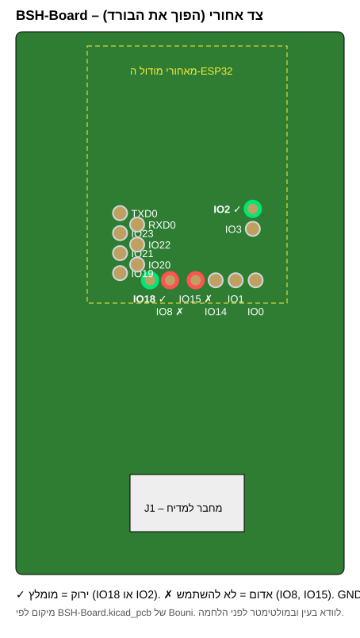

# Bosch SMI25CS00Y/F1 (Serie 2) — D-Bus monitoring + remote Start via opto-relay

Config: [bsh-dbus-smi25cs00y.yaml](bsh-dbus-smi25cs00y.yaml)

## Hardware

- **[Bouni BSH-Board v1.1](https://github.com/Bouni/BSH-Board)** (ESP32-C6) on the D-Bus connector, powered from the 12 V VBus.
- **External Panasonic AQY212EH** PhotoMOS opto-relay (SOP-4), soldered across the two pads of the panel Start button.

### Opto wiring

| AQY212EH pin | Connect to |
|---|---|
| 1 (anode, dot) | Bouni pad **01** (GPIO1) through a **470 Ω** resistor (≈5 mA) |
| 2 (cathode) | Bouni **GND** |
| 3, 4 (output) | The two pads of the panel Start button (no polarity) |

Pins 1 and 2 are on the **same edge** of the package; 3 and 4 are on the opposite edge.

## Findings

- **Monitoring works with the stock `bshdbus` component:** state `27.2007` (01 running / 02 ready / 03 finished / 06 stopping), remaining time `25.2008`.
- **Panel RAM is readable** with `F001` to dest `0x20`, data `[0x20, 0x08, a3, a2, a1, a0]`. The reply comes back as `F101` with 8 bytes.
  On this panel (µPD78F0512), `0xFE4B` bit 5 = Start key pressed. `0xFE41` bit 0 looks like the door (not yet confirmed).
- **Starting over the bus did not work on this model.** We tried F2 RAM writes, key-variable bursts, ACK probes, and injecting `17.10xx` Start frames.
  The panel reads Start only from its own key scan matrix. So the reliable way to start remotely is a physical button bypass.
- **Opto press:** the firmware sends one 500 ms pulse, with an 8 s hard failsafe. A long hold (~6 s) resets the program on this panel.
  The machine's own door interlock still applies.
- **Verified:** while the opto is on, panel RAM `0xFE4B` reads `0x20`, and the program starts.

## Pitfalls we hit

1. The cathode wire was on output pin 4 instead of pin 2. You could see this because both ends of the resistor read 3.25 V, meaning no current.
2. A weak GND solder joint on the board. Check continuity to a real GND pad.
3. The board is powered by VBus, so it goes offline when the machine auto-powers off. Do OTA updates while the machine is on.

## Photos

Photos of the opto board, the Bouni solder points and the Start button pads will follow in this PR.
